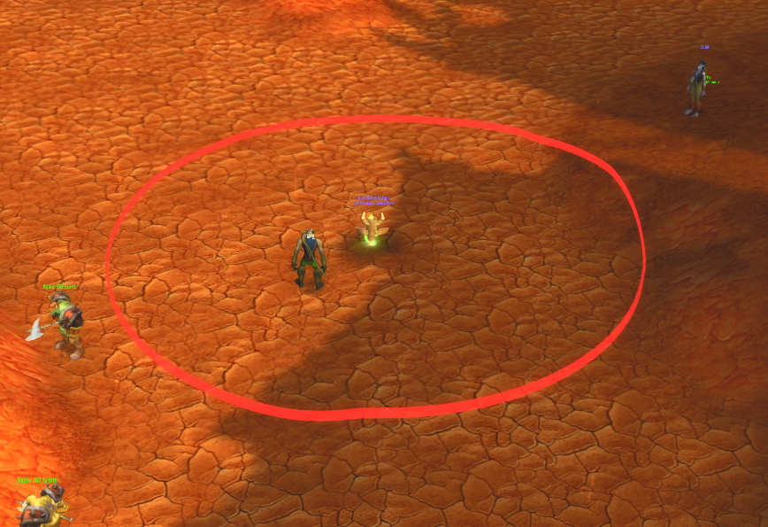
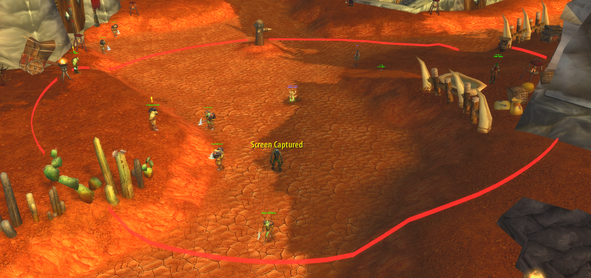

# TotemCircles

Terrain-following 3D range rings with wall occlusion around Shaman totems for **WoW 1.12.1 (OctoWoW / Turtle WoW)**

## Installation

1. Load `ClassicAPI.dll` and `TotemCircles.dll` with your client DLL loader (ClassicAPI first).
2. Copy `addon/TotemCircles` to `Interface/AddOns/TotemCircles`.
3. Enable the addon and enter `/tcr status` in-game.

### Build from source (Windows / Visual Studio 2026)

Requires CMake, Git, and Visual Studio C++ Build Tools with x86 support.

```powershell
cmake -S . -B build -G "Visual Studio 18 2026" -A Win32
cmake --build build --config Release --parallel
```

Output: `build/Release/TotemCircles.dll`.

## Commands

All commands start with `/tcr`. Distances are in **yards**.

| Command | Description |
|---|---|
| `/tcr on` | Enable rings. |
| `/tcr off` | Disable rings. |
| `/tcr hide <1-4>` | Hide individual totem circles |
| `/tcr show <1-4>` | Show individual totem circles |
| `/tcr status` | Show active totems, selected ranges, range sources and settings. |
| `/tcr radius <1-50>` | Set a global radius override. |
| `/tcr auto` | Clear global and slot radius overrides; retain spell/name overrides. |
| `/tcr slot <1-4> <1-50>` | Override radius for an elemental slot. |
| `/tcr spell <spellID> <1-50>` | Override radius for a summon spell ID. |
| `/tcr name <activeSlot> <1-50>` | Override radius for the active totem's name, across ranks. |
| `/tcr clear global` | Remove the global radius override. |
| `/tcr clear slot <1-4>` | Remove an elemental slot override. |
| `/tcr clear spell <spellID>` | Remove a spell ID override. |
| `/tcr clear name <activeSlot>` | Remove the active totem's name override. |
| `/tcr overrides` | List saved radius overrides. |
| `/tcr rangecheck` | Show detected radii, sources and spell descriptions. |
| `/tcr mastery auto` | Detect Totemic Mastery automatically. |
| `/tcr mastery on` | Force Totemic Mastery fallback on. |
| `/tcr mastery off` | Force Totemic Mastery fallback off. |
| `/tcr color <1-4> <RRGGBB>` | Set an elemental ring color using RGB hex. |
| `/tcr color <1-4> <AARRGGBB>` | Set a ring color with alpha (transparency). |
| `/tcr colors` | List current colors. |
| `/tcr colorreset <1-4>` | Reset one color to default. |
| `/tcr colorreset all` | Reset all colors to default. |
| `/tcr height <0.02-5>` | Set ring wall height. |
| `/tcr thickness <0.01-2>` | Set ring thickness. |
| `/tcr segments <12-192>` | Set ring smoothness. |
| `/tcr terrain on/off` | Enable/Disable terrain following. |
| `/tcr occlusion on/off` | Enable/Disable collision-based wall occlusion (default on). |
| `/tcr performance low/balanced/high` | Changes performance options between levels |

### Element slots and default colors

| Slot | Element | Default color |
|---|---|---|
| `1` | Fire | `FF3030` (red) |
| `2` | Earth | `8B5A2B` (brown) |
| `3` | Water | `3090FF` (blue) |
| `4` | Air | `A0A0A0` (gray) |

Example: `/tcr color 2 8B5A2B`

## Automatic ranges and saved settings

Radius priority: **slot override → global override → spell ID override → totem name override → summon-spell description → Totemic Mastery fallback → range table → spell-database fallback → 20 yards**.

All addon settings and overrides are saved in `TotemCirclesDB` and restored on login. WoW writes SavedVariables on `/reload` or a normal logout/exit. Auto-detected ranges may be inaccurate for server-specific totems; use `/tcr rangecheck` and overrides as needed.

## Gallery




## License

See [LICENSE](LICENSE).
